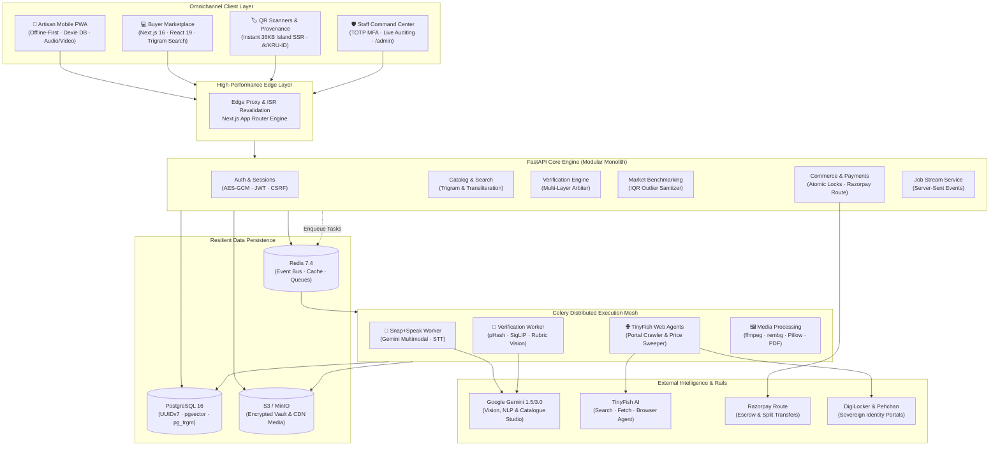
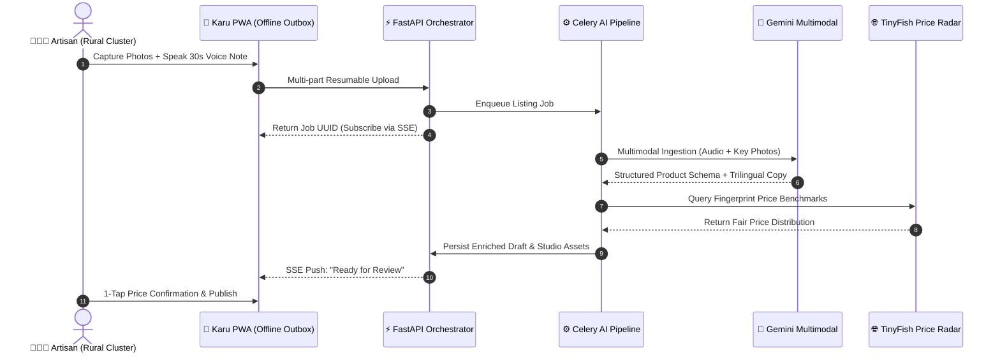
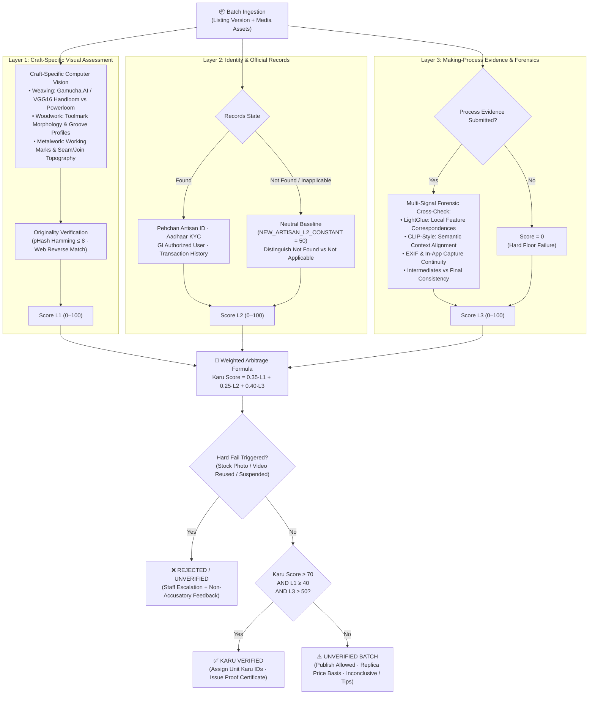
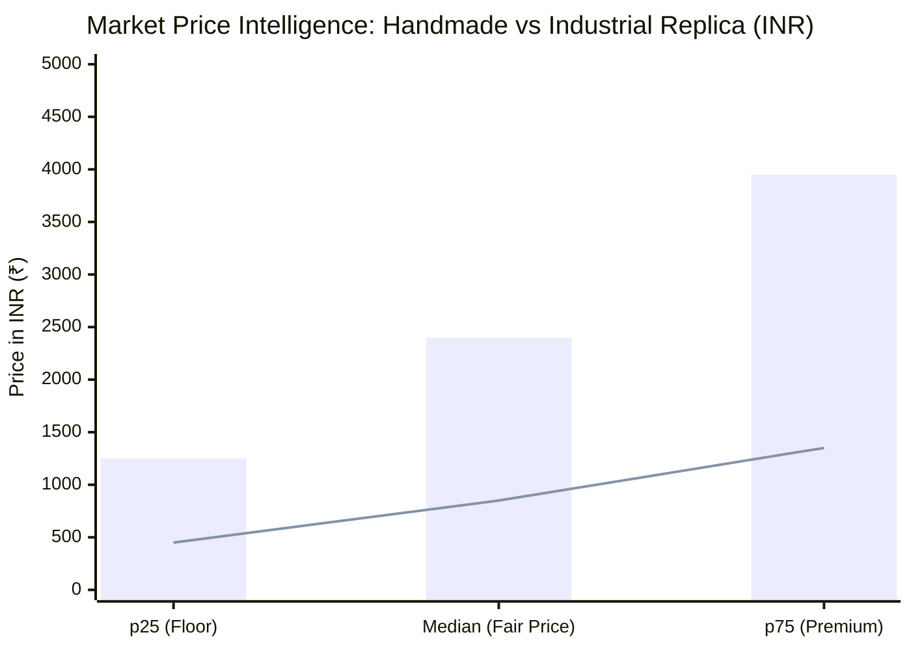
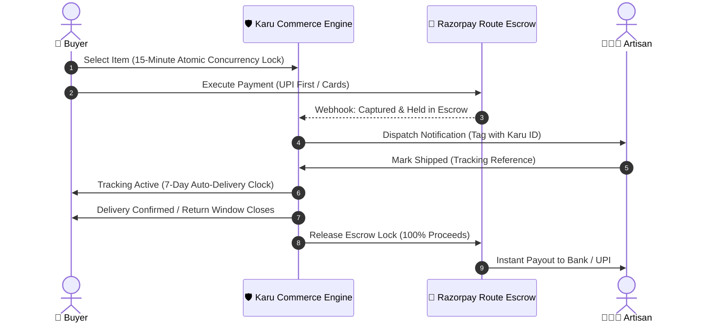

# KARU.AI (कारु)

<div align="center">

```
  ██████╗ ███████╗██████╗ ██╗   ██╗    ███████╗██╗
  ██╔══██╗██╔════╝██╔══██╗██║   ██║    ██╔════╝██║
  ██████╔╝█████╗  ██████╔╝██║   ██║    █████╗  ██║
  ██╔══██╗██╔══╝  ██╔══██╗██║   ██║    ██╔══╝  ██║
  ██║  ██║███████╗██║  ██║╚██████╔╝    ██║     ██║
  ╚═╝  ╚═╝╚══════╝╚═╝  ╚═╝ ╚═════╝     ╚═╝     ╚═╝
```

### Sovereign Physical-Digital Provenance & Multimodal AI Marketplace for Indian Artisans

[](https://fastapi.tiangolo.com)
[](https://nextjs.org)
[](https://www.python.org)
[](https://react.dev)
[](https://www.postgresql.org)
[](https://ai.google.dev/)
[](https://tinyfish.ai)
[](https://razorpay.com)
[](apps/api/tests)
[](LICENSE)

*“We do not generate the product. We help the real product speak for itself.”*

[Architecture](#-system-architecture) • [Core Innovations](#-core-innovations) • [Verification Engine](#-tri-layer-multimodal-verification-engine) • [Live Market Intelligence](#-live-fair-price-discovery-engine) • [Quick Start](#-quick-start--deployment) • [Technical Specs](#-technical-specifications)

---

</div>

## 📌 Executive Summary

India is home to over **7 million master artisans** generating timeless handloom and handicraft treasures. Yet, the craft ecosystem suffers from a catastrophic dual crisis:
1. **The Counterfeit Epidemic:** Power-loom replicas and industrial machine prints masquerade as authentic Geographical Indication (GI) handcrafts, undercutting genuine makers and deceiving consumers.
2. **The Digital Asymmetry Barrier:** Rural artisans lack English proficiency, commercial photography setups, and SEO metadata skills, forcing reliance on exploitative middlemen who retain up to 80% of retail margins.

**KARU.AI** solves this end-to-end through a high-performance **Physical-Digital Provenance Platform & Multimodal AI Marketplace**:
- **Snap + Speak Ingestion:** Zero-form onboarding where a 30-second voice note in any regional Indian dialect plus camera photos instantly synthesizes high-converting, SEO-optimized trilingual listings with professional studio-enhanced photography.
- **Tri-Layer Multimodal AI Verification:** Combines micro-texture computer vision (L1), sovereign identity & Pehchan registry checks via autonomous web agents (L2), and temporal keyframe process video analysis (L3).
- **Cryptographic Physical-Digital Handshake:** Crockford Base-32 **Karu IDs** (`KRU-XXXXXXXX`) and tamper-resistant dynamic QR tag sheets linking directly to ultra-lightweight (36 KB) server-rendered provenance proof pages.
- **TinyFish Autonomous Web Intelligence:** Continuously sweeps the domestic and global web to establish real-time fair market benchmarks, eliminating information asymmetry and recommending fair pricing.
- **Zero-Commission Escrow Rails:** Concurrency-safe atomic reservations with Razorpay Route escrow holding funds until the post-delivery buyer satisfaction window closes.

---

## 🏛️ System Architecture

KARU.AI is built as a cloud-native, modular micro-architecture designed for sub-second edge latency and resilient rural connectivity.



---

## 🚀 Core Innovations

### 1. 🎙️ Autonomous "Snap + Speak" Listing Engine
Artisans never fill out digital forms. The entire listing lifecycle is driven by voice and optical sensing:
1. **Ambient Audio Capture:** Records in the maker's native tongue (Hindi, Punjabi, Marathi, Gujarati, Urdu, Tamil, Malayalam, or English).
2. **Dialect-Resilient Acoustic Parsing:** Normalizes audio to 16 kHz mono WAV; transcribes with confidence scoring and fallback resilience.
3. **Multimodal Extraction:** Gemini vision and language models extract craft taxonomy, dimensions, raw materials, technique, and production lead times into strict schema structures.
4. **Trilingual Catalog Generation:** Automatically authors warm, persuasive, and authentic descriptions in the artisan's source language, English, and Hindi.
5. **AI Studio Image Enhancement:** Auto-levels lighting, normalizes background to rich organic khadi tones, and synthesizes 5 marketplace-grade studio compositions while preserving 100% of the authentic physical piece's features.



---

### 2. 🛡️ Tri-Layer Multimodal Verification Engine
Karu enforces a strict, multi-tiered authenticity verification pipeline designed to distinguish claimed handmade processes from machine-made alternatives while honoring artisan realities.



#### 📐 Mathematical Formulation

$$\text{Karu Score} = 0.35 \cdot L_1 + 0.25 \cdot L_2 + 0.40 \cdot L_3$$

| Layer | Domain | Weight | Hard Minimum | Primary Verification Vectors |
|---|---|:---:|:---:|---|
| **L1** | Craft-Specific Visuals | **35%** | $\ge 40$ | Toolmark morphology, selvedge/weave irregularity, pHash anti-theft crawl |
| **L2** | Identity & Official Records | **25%** | Baseline 50 | DigiLocker Aadhaar, DC Handicrafts Pehchan registry, GI status, reviews |
| **L3** | Process Evidence Forensics | **40%** | $\ge 50$ | LightGlue local matching, CLIP similarity, capture continuity, WIP consistency |

> [!IMPORTANT]
> **Mathematical Integrity by Design:** Because $L_3$ holds a 40% weight and requires a minimum floor of 50, **it is mathematically impossible for any listing to achieve Karu Verified status without authentic making-process evidence** $(0.35 \times 100 + 0.25 \times 100 + 0 = 60 < 70)$.

---

#### 🔍 Layer 1 — Craft-Specific Visual Assessment

Layer 1 operates as a **craft-specific visual assessment** engineered to evaluate surface and geometric clues of claimed handmade production against machine-made or power-loom alternatives, rather than relying on generic AI prompts asking whether an object "looks handmade."

##### 1. Weavers: Gamucha.AI-Inspired Approach
Drawing on research from [*“Handloomed fabrics recognition with deep learning”* (Nature Scientific Reports, 2024)](https://www.nature.com/articles/s41598-024-58750-z) on Assamese gamucha textiles, Karu architectures image-based deep learning (including CNN backbones and custom VGG16-based models) to distinguish genuine handloomed samples from powerloom imitations.
- **Proposed Use:** Serves as a reference for narrow handloom-versus-powerloom discrimination. Results are not assumed to generalize universally across all fabric structures, yarn counts, or textile traditions without dedicated training sets. In early prototypes, the workflow demonstrates this architecture; trained validation must be completed before making production authenticity claims.
- **Limitations:** Image resolution, lighting variance, fabric drape, mechanical finishing (calendaring/sizing), and unseen motifs directly affect feature maps. A model evaluated on gamucha weaves is not a universal textile authenticator.

##### 2. Woodworkers: Hand-Carved vs. Machine/CNC-Made Assessment
Analyzes surface micro-relief and geometric tool signatures rather than subjective visual appeal:
- **Potential Signals to Investigate:**
  - *Toolmark Morphology:* Cutting mark shapes, directionality, spacing variance, and carving depth profiles.
  - *Repeated Geometry:* Recurring groove spacing, bit entry/exit signatures, and uniform pitch characteristic of multi-axis CNC toolpaths.
  - *Surface Topography:* Micro-relief variation across grain boundaries; macro photography and 3D depth-profiling provide critical discrimination beyond flat RGB images.
  - *Construction Details:* Mortise/tenon joints, joinery transitions, and undercut finishing assessed in context.
- **Evaluation Protocol:**
  1. Capture standardized macro views under raking light to emphasize surface relief.
  2. Map local texture vectors, mark directionality, groove spacing, and repetitive cyclic patterns.
  3. Where feasible, integrate depth/surface profilometry alongside 2D RGB imagery.
  4. Benchmark against reference datasets: hand-carved, CNC/machine-routed, and hybrid/hand-finished pieces.
  5. **Default to Inconclusive:** When physical evidence is ambiguous, return an inconclusive verdict rather than an erroneous classification.
- **Limitations:** Skilled human artisans achieve high regularity; CNC pieces may be hand-sanded or hand-finished; intensive sanding removes diagnostic toolmarks. Hybrid creations must not be falsely flagged as counterfeit.

##### 3. Metal Artisans: Hand-Worked vs. Machine-Made Assessment
Evaluates structural features aligned with specific manufacturing claims (e.g., hand-hammered, cast, engraved, spun, or hand-finished):
- **Potential Signals to Investigate:**
  - *Hammering / Working Marks:* Planishing facets, overlap patterns, force variance, and radial distribution.
  - *Engraving & Chasing:* Tool chatter, micro-burrs, hand-guided trajectory variance versus CNC laser/rotary engraving.
  - *Repeated Geometry:* Mathematical mark repetition indicative of stamping, hydraulic pressing, or automated spinning.
  - *Seams & Joins:* Braze/solder fillets, seam thickness transitions, and hand-filing marks.
  - *Surface Topography:* Macro-texture and profilometry revealing working stress marks.
- **Evaluation Protocol:**
  1. Accurately capture claimed technique (hand-hammered, lost-wax cast, hand-chased, hand-spun).
  2. Capture calibrated close-up details of load-bearing seams, internal surfaces, and decorative tooling.
  3. Compare candidate texture and geometric variance against known artisan and industrial exemplars.
  4. Validate across diverse craft clusters and hybrid finishing variations.
  5. Designate as *inconclusive* when visual indicators fail to distinctly isolate the process.
- **Limitations:** Cast or stamped blanks are frequently hand-chased; master metalworkers achieve remarkable symmetry; hammer facets can be mechanically simulated. Hallmarking verifies precious metal fineness, **not** handmade origin.

> [!NOTE]
> **Shared Layer 1 Principle:** A unified inspection pipeline utilizing craft-specialized model heads. A weaving model is never reused as a wood or metal classifier without dedicated domain calibration and validation. For evaluations and Q&A, Layer 1 represents craft-specific visual assessment designed to separate handmade methods from machine substitutes; prototype outputs demonstrate pipeline capability and require formal dataset validation before production deployment.

---

#### 🏛️ Layer 2 — Identity & Official Records

Layer 2 evaluates authoritative, external documentation to corroborate artisan claims, where accessible and legally verifiable:
- **Scope of Records:** Government artisan registries (DC Handicrafts Pehchan cards), Geographical Indication (GI) authorized user registries, state handicraft board records, cooperative memberships, and institutional credentials.
- **Core Operating Principles:**
  - *Inclusive by Design:* Not every genuine master artisan possesses GI registration or a formal digital paper trail. The absence of records **must never** automatically flag an artisan or product as counterfeit.
  - *Contextual GI Applicability:* GI status applies strictly to designated craft clusters/products and is not a universal mandate for authentic handmade goods.
  - *Explicit Tri-State Logic:* Records are strictly classified into **`record found`**, **`record not found`**, or **`not applicable`** (avoiding binary pass/fail penalization).
  - *Integration Transparency:* Simulated or mock responses in development are strictly demarcated until live portal connectivity is validated.
- **Supporting Role:** Layer 2 provides contextual trust corroboration; it does not independently verify that a specific physical item was handcrafted.

---

#### 🎬 Layer 3 — Making-Process Evidence & Anti-Replay Forensics

Artisans submit work-in-progress (WIP) video/photos, raw material stages, intermediate assembly captures, and final piece photos linked directly to the batch's **Karu ID**. The objective is to verify that the submitted process evidence is visually, physically, and contextually consistent with the finished article.

##### Forensic Defense Against Reused & Synthetic Media
Because no single automated algorithm reliably authenticates video, Karu ensembles multiple independent verification signals:

- **A. LightGlue — Local Visual-Feature Matching:**
  - *Mechanism:* Employs deep local feature matching (LightGlue) across process video keyframes and final product gallery images.
  - *Application:* Identifies corresponding unique surface features (grain patterns, weave irregularities, hand-painted strokes) visible across different viewing angles and production phases.
  - *Limitations:* Correspondences confirm visual similarity between frames, not authorship. Batch variations, finishing steps, or reused footage from similar stock can produce false correspondences.
- **B. CLIP-Style Embeddings — Semantic Relationship:**
  - *Mechanism:* Computes vision-language embeddings to verify semantic alignment between claimed materials, techniques, and visible process footage.
  - *Application:* Confirms process frames relate contextually to the target craft taxonomy.
  - *Limitations:* Two different brass urns or walnut carvings exhibit near-identical semantic vectors. Semantic similarity establishes categorical relevance, never unique physical identity.
- **C. EXIF Metadata Timeline Analysis:**
  - *Mechanism:* Inspects capture timestamps, sensor profiles, and camera hardware parameters.
  - *Application:* Provides auxiliary timeline consistency checks across intermediate milestones.
  - *Limitations:* Metadata is frequently stripped by messaging apps or easily manipulated. Missing EXIF metadata is common on budget devices and **never** constitutes grounds for listing rejection.
- **D. Controlled In-App Capture & Continuity:**
  - *Mechanism:* Controlled camera workflows tie media ingestion directly to an issued Karu ID with immutable server receipt timestamps.
  - *Application:* Tracks evidence creation chronological order and verifies media lineage.
  - *Limitations:* Software device continuity does not constitute hardware-level attestation. A continuous capture session does not independently prove who executed the manual labor.
- **E. Multi-Stage Evidence Cross-Checking:**
  - *Mechanism:* Evaluates holistic consistency across raw inputs, intermediate states, and finished goods.
  - *Resolution:* If visual indicators are incomplete, conflicting, or non-distinctive, the system routes the listing to human review or marks it **inconclusive** rather than issuing an accusatory rejection.

##### Defensible Strategy for AI-Generated & Deepfake Media
Karu adopts an honest, scientifically grounded security posture: **no algorithm can guarantee 100% detection of advanced generative video.** Rather than making unsupportable detection claims, Karu deploys a 6-step defensible framework:
1. Prioritize controlled, product-specific in-app capture flows where practical.
2. Bind every evidence asset immutably to a single Karu ID with verifiable upload audit logs.
3. Match high-resolution process micro-features directly against final finished product details.
4. Treat file and device metadata strictly as supplementary context.
5. Flag anomalies and temporal discrepancies for specialist human inspection.
6. Retain an **inconclusive** verdict whenever forensic evidence is insufficient to reach certainty.

This robust multi-signal architecture significantly raises the cost of submitting fraudulent or scraped footage without penalizing authentic rural creators.

---

### 3. 🏷️ Cryptographic Physical-Digital Handshake
Every single physical item manufactured is bound to a unique, collision-proof digital twin:
- **Crockford Base-32 Human Codes:** Identifiers like `KRU-8F29A1QZ` and passports `KRP-9X2M4K7L` eliminate ambiguous characters (`I`, `L`, `O`, `U`) for error-free voice transmission.
- **Dynamic A4 QR Tag Generator:** Direct PDF compilation producing high-density tag sheets with Error Correction Level Q (tolerates up to 25% physical damage/ink bleed).
- **Sub-50ms Island Proof Pages (`/k/[karuId]`):** Anonymous, ultra-optimized server-rendered entry points (36 KB payload) displaying the maker's voice, geo-origin, video proof, and supply-chain custody journey.

```
┌─────────────────────────────────────────────────────────────┐
│                      KARU VERIFIED™                         │
│                    KRU - 8F29A1QZ                           │
├──────────────────────────────┬──────────────────────────────┤
│  █████████████  ▄▄▄▄▄ █▀▄    │  CRAFT: Bhagalpuri Tussar    │
│  ██         ██  █▀▄▀█ █ █    │  ARTISAN: Devki Devi         │
│  ██   ███   ██  ▄▄▄ █ ▄▀█    │  CLUSTER: Bhagalpur, Bihar   │
│  ██   ███   ██  █▀▄▀█ ▄▄█    │  TECHNIQUE: Handloom Woven   │
│  █████████████  █ █ █ ▄ █    │  VERIFIED SCORE: 88.4 / 100  │
├──────────────────────────────┴──────────────────────────────┤
│  SCAN TO MEET THE MAKER · 100% GENUINE HANDMADE PROVENANCE  │
└─────────────────────────────────────────────────────────────┘
```

---

### 4. 📈 Live Fair-Price Discovery Engine
Powered by **TinyFish Web Intelligence**, Karu crawls, ingests, and extracts market pricing across commercial e-commerce platforms to eliminate price asymmetry for rural clusters.



*Bars = Verified Authentic Handcrafted Distribution | Line = Industrial Power-Loom Replica Baseline*

- **Autonomous Web Scraping & Cleaning:** Extracts live pricing from boutique craft platforms and mass-market portals based on category, craft technique, and material fingerprint.
- **Statistical Filtering:** Applies Interquartile Range (IQR) sanitization to strip extreme anomalies and predatory listings.
- **Artisan Price Radar:** Displays real-time positioning (*Below Market*, *Fair Market*, *Above Market*) with a one-tap price update recommendation. **Karu never modifies an artisan's price unilaterally.**

---

### 5. 💳 Zero-Commission Escrow Rails
Karu operates a transparent financial model designed to build lasting trust between urban patrons and rural creators.



- **15-Minute Concurrency Shield:** Employs atomic row-level database conditional updates (`UPDATE ... WHERE status = 'available'`) ensuring two buyers can never purchase the same one-of-a-kind physical piece.
- **Milestone-Based Escrow:** Full funds are isolated in escrow until the inspection and return window expires.
- **0% Commission for Artisans:** 100% of the listed price transfers directly to the artisan's linked account.

---

## 🗂️ Monorepo Structure

```
KARU/
├── apps/
│   ├── api/                          # FastAPI Modular Monolith (Python 3.12)
│   │   ├── app/
│   │   │   ├── core/                 # DB, Security, UUIDv7, Crockford-32, i18n
│   │   │   ├── modules/
│   │   │   │   ├── ai_pipeline/      # Snap+Speak orchestration & Gemini synthesis
│   │   │   │   ├── verification/     # 3-Layer forensic analysis engine
│   │   │   │   ├── pricing/          # TinyFish benchmark ingestion & clustering
│   │   │   │   ├── karu_ids/         # ID lifecycle & PDF tag sheet rendering
│   │   │   │   ├── orders/           # Atomic cart, checkout & reservation timers
│   │   │   │   ├── payments/         # Razorpay Route split payment & escrow holds
│   │   │   │   ├── artisans/         # Passport, KYC, Pehchan validation
│   │   │   │   └── admin/            # Mission Control API & audit logging
│   │   │   └── providers/            # Pluggable Gemini, Whisper, TinyFish, Razorpay
│   │   ├── migrations/               # Alembic asynchronous database migrations
│   │   └── tests/                    # 34 comprehensive end-to-end test suites
│   └── web/                          # Next.js 16 App Router (React 19 & Tailwind v4)
│       ├── app/
│       │   ├── (market)/             # Buyer marketplace, craft clusters & stories
│       │   ├── sell/                 # Artisan offline PWA, mic inputs & dashboard
│       │   ├── admin/                # Staff console, live metrics & verification queue
│       │   └── k/[karuId]/           # Instant 36KB SSR provenance proof page
│       ├── components/               # High-craft design system (Radix + Lucide)
│       ├── lib/                      # TanStack Query, Dexie IndexedDB, SSE Client
│       └── messages/                 # Complete 8-language localization catalogues
├── infra/
│   └── docker-compose.yml            # Full production-grade orchestration stack
└── docs/                             # Comprehensive specifications & architectural briefs
```

---

## 💻 Technical Specifications

| System Dimension | Specification | Implementation Detail |
|---|---|---|
| **Web Runtime** | Next.js 16.4 (App Router) | React 19, Turbopack, Server Components, Route Groups |
| **Styling & Design Tokens** | Tailwind CSS v4.3 | Native `@theme` tokens (Indigo, Haldi, Peacock, Khadi), logical RTL spacing |
| **API Runtime** | Python 3.12 · FastAPI | Async SQLAlchemy 2.0, Pydantic v2, Uvicorn worker clustering |
| **Database & Search** | PostgreSQL 16.4 | `pg_trgm` (trigram fuzzy matching), `pgvector`, `unaccent`, UUIDv7 PKs |
| **Distributed Queue** | Redis 7.4 + Celery | Distinct queues for AI extraction, verification, pricing, and notifications |
| **Object Storage** | MinIO / AWS S3 | Automatic EXIF GPS stripping, multi-variant WebP/AVIF generation |
| **Multimodal Vision** | Google Gemini 1.5/3.0 | Structured JSON extraction, texture analysis, automated catalogue composition |
| **Web Intelligence** | TinyFish API Suite | Live search, clean markdown fetching, headless browser agents |
| **Payment Rails** | Razorpay Route | UPI-first standard checkout, split transfers, escrow holds |
| **Offline Resilience** | Dexie.js (IndexedDB) | Resumable chunked uploads, service worker Background Sync |
| **Cryptographic PII** | AES-GCM 256-bit | Encryption for legal name, DOB, Aadhaar last-4, bank account/IFSC |
| **Internationalization** | 8 Indic Languages | Hindi, English, Punjabi, Marathi, Gujarati, Urdu (RTL), Tamil, Malayalam |

---

## ⚡ Quick Start & Deployment

### Option 1: Full Staging Stack via Docker Compose (Recommended)

Spin up the entire distributed topology (Postgres 16, Redis, MinIO, FastAPI, Celery Worker, Celery Beat, and Next.js 16) with a single command:

```bash
docker compose -f infra/docker-compose.yml up --build
```

- **Marketplace & Artisan Portal:** `http://localhost:3000`
- **Interactive OpenAPI Documentation:** `http://localhost:8000/docs`
- **MinIO Storage Console:** `http://localhost:9001` (User: `karu`, Pass: `karu-minio-secret`)

---

### Option 2: Local Development Setup

#### 1. Backend API (`apps/api`)

```bash
cd apps/api

# Create and activate Python 3.12 virtual environment
python -m venv .venv
# Windows:
.venv\Scripts\activate
# Linux/macOS:
# source .venv/bin/activate

# Install production and development dependencies
pip install -r requirements-dev.txt

# Configure environment variables (defaults to resilient offline mock providers)
cp .env.example .env

# Run database migrations and seed synthetic artisan clusters
python -m app.scripts.seed

# Launch asynchronous API server
uvicorn app.main:app --host 0.0.0.0 --port 8000 --reload
```

#### 2. Frontend Application (`apps/web`)

```bash
cd apps/web

# Install packages
npm install

# Start Next.js development server with Turbopack
npm run dev
```

Visit [http://localhost:3000](http://localhost:3000) to explore the marketplace.

---

## 🧪 Quality Assurance & Test Verification

The codebase maintains rigorous automated test suites across all domains:

```bash
# Execute API unit, integration, and security test suite (34 passing suites)
cd apps/api
pytest -q
ruff check app tests

# Execute Frontend TypeScript validation, ESLint & i18n key consistency checks
cd apps/web
npm run typecheck
npm run lint
npm run check:i18n
npm run build
```

```
============================== 34 passed in 4.12s ==============================
✓ Verification scoring floors & hard fails tested
✓ Zero-commission escrow calculations & hold release validated
✓ Atomic inventory race conditions verified
✓ Cross-artisan security boundaries & CSRF double-submit protected
✓ Trigram & Hinglish transliteration search verified
✓ 49 App routes compiled cleanly with 0 TypeScript errors
```

---

## 🔐 Security, Privacy & DPDP Compliance

- **Sovereign Data Protection (DPDP Act Ready):** All PII (full legal name, date of birth, Pehchan card numbers, Aadhaar last-4, and bank IFSC details) is secured using authenticated **AES-GCM encryption** at the application layer.
- **Privacy-Preserving Geolocation:** Raw GPS coordinates are scrubbed from public EXIF metadata. Artisan workshop locations are fuzzily clustered to ~1 km accuracy, exposing only district and village names publicly.
- **Hardware-Level MFA:** Staff command center operations (`/admin`) require mandatory TOTP multi-factor authentication (`pyotp`).
- **Cryptographic Session Defense:** Scoped HTTP-only rotating refresh cookies, short-lived JWT access tokens, and double-submit anti-CSRF protection.

---

## 👥 Built with Pride by Team Northern Blades

- **Vedant** — UI/UX Strategy & Product Architecture
- **Alshifa** — Indic Design Systems & Design Tokens
- **Sawant** — Backend Architecture, Concurrency & Escrow Rails
- **Nishant** — Multimodal AI Pipeline, Forensics & Web Agents

*Empowering the hands that weave India's cultural soul.*
