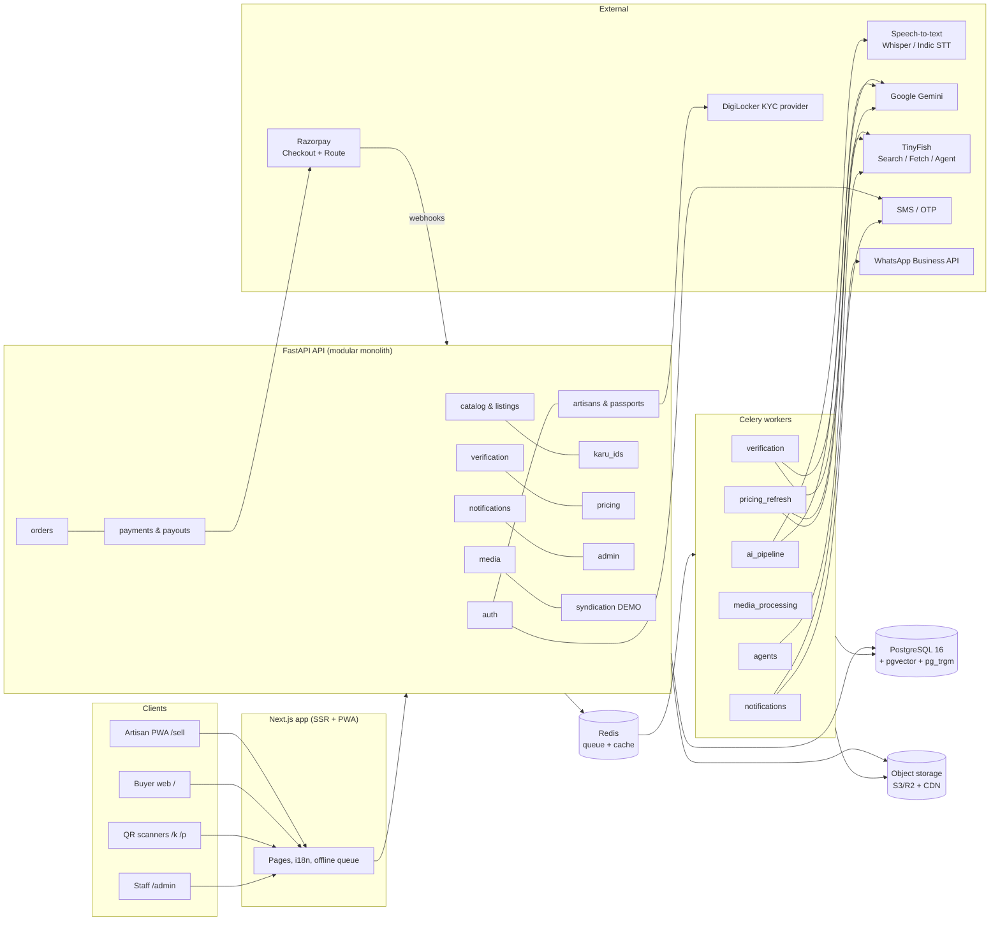
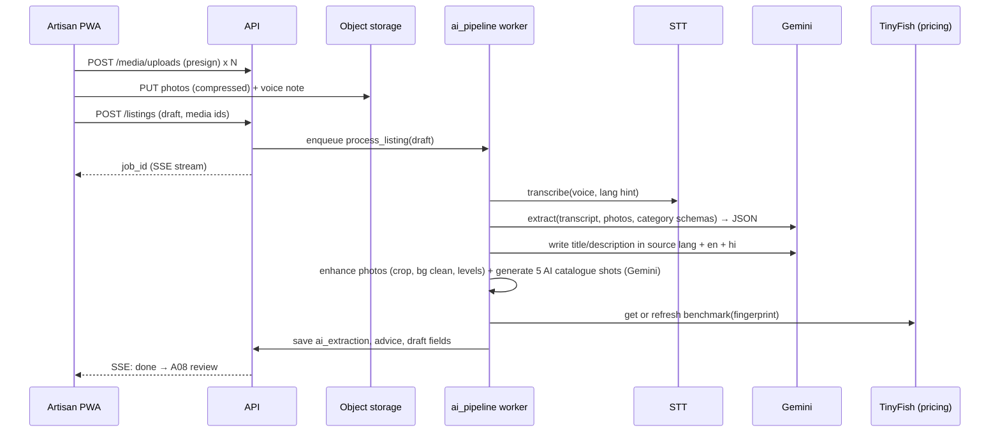
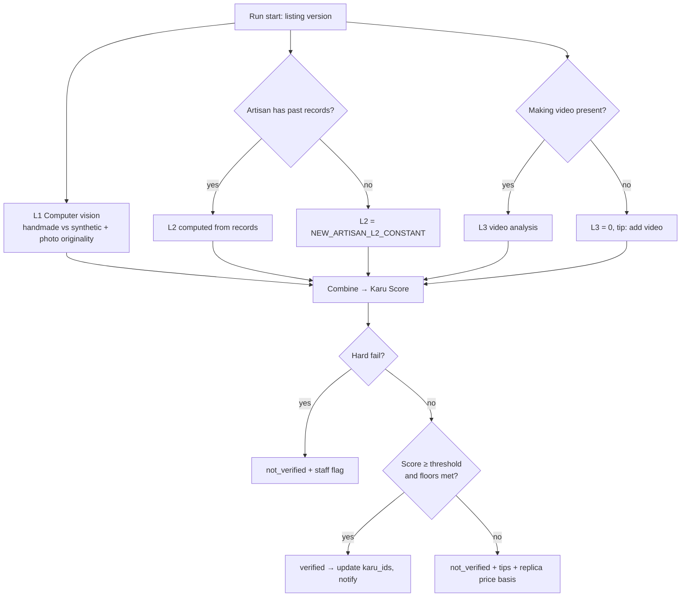
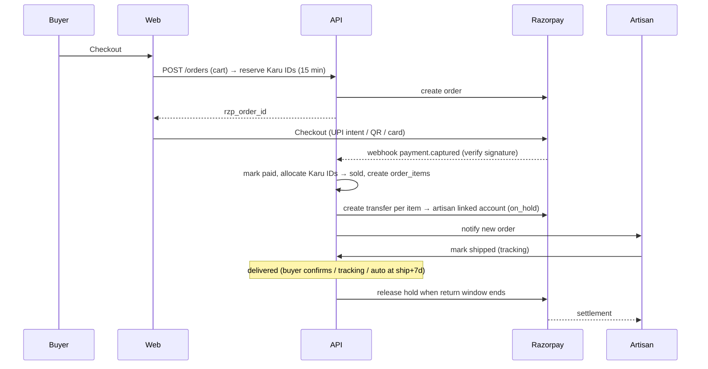

# KARU.AI — Technical Design Spec

> **Part 2 of 2.** Architecture, system design, data model, APIs, AI/ML, TinyFish, payments, security, infrastructure, testing and build order.
> **Part 1** is `KARU_PRODUCT_SPEC.md` (behaviour, flows, screens, design system). Read it first. Screen IDs (A05, B06 …) and tags **[DEMO] [PILOT] [LATER] [DEFAULT]** mean the same here.
> Where the team's written answers differ from the original deck, the answers win.

Version 1.0 · 2026-10-24

---

## 1. Architecture overview

Karu is a **modular monolith** API (FastAPI) with **background workers**, one **Next.js web app** serving all surfaces (marketplace, artisan dashboard, Karu ID pages, admin), PostgreSQL as the source of truth, Redis for queues/cache, and S3-compatible object storage for media. External services: speech-to-text, Gemini, TinyFish, payment gateway, OTP/SMS, WhatsApp, KYC provider.

A monolith is the right call for a team of four and a pilot: one deploy, one database, clear module boundaries so pieces can split out later.



**Key design choices**
- All slow or external work (AI extraction, verification, price refresh, media processing, notifications, agents) runs in **workers**, never in the request path. The API returns a job ID; the client watches progress via **Server-Sent Events** (`/api/v1/jobs/{id}/events`) with polling fallback.
- **Provider abstraction**: every external service sits behind an interface in `app/providers/` (e.g. `SpeechToText`, `LLM`, `WebIntel`, `Payments`, `Messaging`, `KYC`) with a real implementation and a **fake** for tests and offline demo rehearsals.
- **Config over code** for verification weights, thresholds, price bands and feature flags (DB table `app_config`, cached in Redis, editable in S06).
- **India region** for data (AWS `ap-south-1` Mumbai or equivalent) for the pilot; DPDP Act friendly.

---

## 2. Tech stack

| Layer | Choice | Notes |
|---|---|---|
| Web framework | **Next.js (App Router) + TypeScript** | SSR for SEO and fast Karu ID pages; one app for all surfaces via route groups |
| Styling | **Tailwind CSS** with CSS variables from Part 1 §9 tokens | RTL via logical properties (`ms-`, `me-`, `ps-`, `pe-`) |
| UI primitives | Radix UI primitives (via shadcn/ui-style local components), Lucide icons | Own components per Part 1 §9.6 |
| i18n | `next-intl` | 8 locales: `hi`, `en`, `pa`, `mr`, `gu`, `ur` (RTL), `ta`, `ml` |
| Data fetching | TanStack Query; `react-hook-form` + `zod` | Shared zod schemas generated from OpenAPI (`openapi-typescript`) |
| PWA / offline | Serwist (service worker), IndexedDB via Dexie, Background Sync | Offline draft + upload queue for artisans |
| Media capture | `<input type="file" accept="image/*" capture="environment">`, MediaRecorder for audio, native camera for video | `browser-image-compression` client-side |
| API | **Python 3.12, FastAPI, Pydantic v2** | Matches deck; OpenAPI is the contract |
| ORM / migrations | SQLAlchemy 2.x (async) + Alembic | |
| DB | **PostgreSQL 16** + `pgvector` + `pg_trgm` + `unaccent` | Managed (RDS / Neon / Supabase) |
| Queue / cache | **Redis** + **Celery** (+ Celery Beat for schedules) | Separate queues per job type |
| Object storage | S3-compatible (AWS S3 ap-south-1 or Cloudflare R2) + CDN | Private bucket for originals, public CDN for derivatives |
| Images | Pillow, `qrcode`, `imagehash`, `rembg` (background cleanup) | Matches deck (Pillow for QR card) |
| Video | ffmpeg (keyframes, transcodes, thumbnails) | |
| STT | OpenAI Whisper (per deck) behind `SpeechToText`; pluggable Indic STT (Sarvam AI / AI4Bharat IndicConformer / Bhashini) | Dialect accuracy, see §6.1 |
| LLM / vision | **Google Gemini API** (per deck) behind `LLM` | Model name in config, not code |
| Image embeddings | SigLIP / CLIP (open weights, CPU inference OK for pilot) | For photo↔video match and duplicates |
| Web intelligence | **TinyFish** Search, Fetch, Agent APIs | §8 |
| Payments | **Razorpay** Standard Checkout + **Route** (split/transfer to artisan linked accounts) | UPI promoted; cards incl. international |
| OTP / SMS | MSG91 (India) or Twilio Verify (international) behind `Messaging` | |
| WhatsApp | Meta WhatsApp Cloud API (or a BSP like Gupshup/Interakt) | Template messages per language |
| KYC | DigiLocker-based Aadhaar via a licensed provider (e.g. Digio, Setu, HyperVerge, Signzy) | §11.2 |
| Monitoring | Sentry (web + API + workers), structured JSON logs, uptime checks | |
| Analytics | PostHog (self-host or EU/US cloud; avoid PII in events) | |
| CI/CD | GitHub Actions; Docker images | |
| Hosting | Web: Vercel (or container on the same cloud). API/workers: AWS ECS Fargate / Fly.io / Render for demo | §12 |

Version policy: pin exact versions in `package.json`/`pyproject.toml`; use current stable releases at build time.

---

## 3. Repository structure (monorepo)

```
karu/
├── apps/
│   ├── web/                      # Next.js
│   │   ├── app/
│   │   │   ├── [locale]/(market)/...      # B01–B17
│   │   │   ├── [locale]/sell/...          # A01–A20
│   │   │   ├── [locale]/admin/...         # S01–S08
│   │   │   ├── k/[karuId]/page.tsx        # B06 (locale from Accept-Language/cookie)
│   │   │   └── p/[code]/page.tsx          # short product links
│   │   ├── components/ (ui/, artisan/, market/, proof/)
│   │   ├── lib/ (api client, offline queue, media, i18n)
│   │   ├── messages/{hi,en,pa,mr,gu,ur,ta,ml}.json
│   │   └── public/ (fonts subsets, icons, motif svg)
│   └── api/                      # FastAPI + workers (same codebase)
│       ├── app/
│       │   ├── main.py
│       │   ├── core/ (config, db, security, ids, i18n, errors)
│       │   ├── modules/
│       │   │   ├── auth/ users/ artisans/ passports/
│       │   │   ├── catalog/ karu_ids/ media/
│       │   │   ├── verification/ pricing/ ai_pipeline/
│       │   │   ├── orders/ payments/ payouts/ returns/ reviews/
│       │   │   ├── requests/ bulk/ notifications/ admin/ syndication/
│       │   │   └── each: router.py, schemas.py, models.py, service.py, tasks.py
│       │   ├── providers/ (stt, llm, webintel, payments, messaging, kyc, embeddings) + fakes/
│       │   └── workers/celery_app.py
│       ├── migrations/ (alembic)
│       └── tests/ (unit, integration, fixtures/recorded)
├── ml/                           # notebooks + training for L1 classifier; eval sets
├── packages/
│   └── api-types/                # generated TS types from OpenAPI
├── infra/ (docker-compose.yml, terraform/ or render.yaml, nginx)
├── docs/ (this spec, ADRs)
└── .github/workflows/
```

---

## 4. Identifiers

| Entity | Format | Generation |
|---|---|---|
| Internal primary keys | UUIDv7 | Time-sortable, never shown in URLs except admin |
| Passport | `KRP-` + 8 Crockford base32 chars | 40 random bits; unique index; retry on collision |
| Karu ID (unit) | `KRU-` + 8 Crockford base32 chars | Same; excludes I, L, O, U to avoid confusion |
| Product short code | 7 Crockford base32 chars | For `/p/{code}` links |
| Maker handle | slug of display name + 4 chars | Editable once |
| Order number | `KO-YYMMDD-XXXXX` | Human-friendly |

IDs are case-insensitive on input, normalised to uppercase. QR codes encode full URLs: `https://karu.ai/k/KRU-8F29A1QZ` and `https://karu.ai/p/AB12CD3`. QR error correction level **Q** (survives print damage and logo overlay).

---

## 5. Data model

PostgreSQL. All tables have `id uuid pk`, `created_at`, `updated_at` unless noted. `jsonb` used where the shape varies by category. PII columns marked 🔒 are encrypted at application level (AES-GCM, key from KMS/secret).

### 5.1 Identity & accounts

```
users
  phone_e164 🔒 (unique, nullable)   email (unique, nullable)   google_sub (unique, nullable)
  display_name   locale (hi|en|pa|mr|gu|ur|ta|ml)   roles text[]  -- buyer, artisan, admin, moderator, ops
  status (active|suspended|deleted)   last_login_at

auth_otps            phone_or_email_hash, code_hash, expires_at, attempts, purpose
refresh_tokens       user_id, token_hash, expires_at, revoked_at, user_agent, ip_hash
consents             user_id, consent_type (terms|privacy|public_voice|public_video|marketing), version, granted_at, revoked_at

artisan_profiles     (1:1 users)
  user_id   legal_name 🔒   public_name   dob 🔒   gender (optional)
  crafts text[]   years_of_practice   village_town   district   state   pin_code   lat/lng (rounded to ~1 km)
  story_text jsonb {lang: text}   story_voice_media_id   show_voice_publicly bool
  profile_photo_media_id   handle (unique)   languages text[]
  profile_completion int (0–100, derived)
  aadhaar_status (none|pending|verified|failed)   aadhaar_last4 🔒   aadhaar_verified_at   kyc_provider_ref
  pehchan_card_no 🔒   pehchan_status (none|pending|verified|failed)   pehchan_evidence_id
  gi_registration jsonb (optional)
  linked_social_urls text[]           -- own shops/Instagram, used to avoid false photo-duplicate flags
  payout_status (none|pending_kyc|active|failed)   razorpay_linked_account_id

passports            (1:1 artisan)
  artisan_id   passport_code (KRP-…, unique)   state (unverified|verified|suspended)
  state_reason   verified_at   suspended_at   last_evaluated_at

buyer_profiles       user_id, default_address_id, country, currency_pref
addresses            user_id, name, phone 🔒, line1, line2, city, state, pin, country, is_default
```

### 5.2 Catalog

```
categories           slug, parent_id, name jsonb{lang}, attribute_schema jsonb, icon, sort
crafts               slug, name jsonb, description jsonb, gi_tag bool, regions text[], hero_media_id   -- craft & cluster pages

listings             (one published product = one batch)
  artisan_id   category_id   craft_id   short_code (unique)
  status (draft|processing|published|paused|deleted)
  title jsonb{lang}   description jsonb{lang}   source_lang
  attributes jsonb     -- material, technique, dye, dimensions, weight, time_to_make_days, care, colour…
  tags text[]
  price_inr numeric(10,2)   compare_at_inr (null)   currency 'INR'
  quantity_total int   quantity_available int   -- derived from karu_ids, kept for fast reads
  returnable bool default true
  shipping jsonb (weight_g, dims_cm, ships_in_days)       -- placeholder for later shipping integration
  verification_status (none|checking|verified|not_verified|revoked)
  current_verification_run_id
  price_position (below|in_range|above|unknown)   current_benchmark_id
  search_tsv tsvector   translit_text text      -- for search (§9.6)
  image_embedding vector(768)                    -- primary photo embedding (duplicates, similar items)
  published_at   paused_at   deleted_at
  views_count   share_count

listing_versions     listing_id, version, snapshot jsonb, changed_fields text[], created_by
                     -- every edit kept; verification references a version

media
  owner_user_id   kind (photo|voice|video|derived_image|share_image|document|evidence_screenshot)
  storage_key (private)   public_key (nullable, CDN)   mime   bytes   width/height/duration_s
  sha256   phash (photos)   video_fingerprint (bytea, videos)
  exif jsonb (private; GPS stripped from any public derivative)
  status (uploading|ready|failed|quarantined)

listing_media        listing_id, media_id, role (photo|enhanced_photo|voice_note|making_video), position, is_primary

ai_extractions       listing_id, input_media_ids, transcript jsonb{lang, text, confidence},
                     extracted jsonb, field_confidence jsonb, model_versions jsonb, cost_inr, duration_ms
```

### 5.3 Karu IDs

```
karu_ids
  code (KRU-…, unique)   listing_id   artisan_id   listing_version
  status (available|reserved|sold|returned|retired)
  verification_run_id (the run that covers this unit; null = not verified)
  reserved_until   order_item_id (null)
  current_owner_user_id (null)
  created_at

karu_id_events       karu_id, event (created|reserved|released|sold|shipped|delivered|returned|retired|ownership_transferred|scanned),
                     actor_user_id, data jsonb, at
                     -- powers the "journey" section on B06; scan events sampled/aggregated to avoid bloat
```

### 5.4 Verification

```
verification_runs
  listing_id   listing_version   triggered_by (publish|edit|retry|periodic|admin)
  status (queued|running|completed|failed)
  l1_score  l2_score  l3_score  (numeric 0–100, null if layer not run)
  l2_mode (computed|new_artisan_constant)
  karu_score numeric   verdict (verified|not_verified)   hard_fail bool   hard_fail_reason
  config_snapshot jsonb       -- weights/thresholds used, for audit and re-scoring
  artisan_tips jsonb          -- localized tips per failing layer
  started_at  completed_at  cost_inr

verification_layer_results
  run_id   layer (L1|L2|L3)   score   sub_scores jsonb   evidence jsonb   model_versions jsonb   raw_response_ref

evidence_items       run_id or artisan_id, kind (registry_screenshot|web_match|price_source|video_analysis),
                     source_url, captured_at, media_id, summary jsonb
image_matches        media_id, matched_url, matched_domain, similarity, first_seen_at, is_own_channel bool
```

### 5.5 Pricing

```
price_benchmarks
  fingerprint (hash of category + craft + material + technique + size bucket)   -- shared across listings
  handmade_p25  handmade_median  handmade_p75   replica_p25  replica_median  replica_p75
  sample_size_handmade  sample_size_replica   currency 'INR'
  refreshed_at   expires_at   status (fresh|stale|failed)

price_sources        benchmark_id, url, domain, title, price_inr, class (handmade|replica|unknown), confidence, fetched_at

listing_price_advice listing_id, benchmark_id, basis (handmade|replica), position, suggested_inr,
                     message_key, shown_at, accepted bool
```

### 5.6 Commerce

```
carts / cart_items   user_id; listing_id, qty
orders
  order_number   buyer_user_id   status (pending_payment|paid|cancelled|partially_shipped|completed|refunded)
  currency   subtotal   shipping_fee   total   shipping_address jsonb (snapshot)
  payment_provider 'razorpay'   rzp_order_id
order_items
  order_id   listing_id   artisan_id   karu_id (allocated unit)   unit_price   returnable (snapshot)
  fulfilment_status (to_pack|shipped|delivered|return_requested|returned|cancelled)
  courier  tracking_no  shipped_at  delivered_at  return_window_ends_at
payments             order_id, rzp_payment_id, method (upi|card|netbanking|wallet|intl_card), amount, status, raw jsonb
refunds              order_item_id, rzp_refund_id, amount, status, reason
transfers (payouts)  order_item_id, artisan_id, rzp_transfer_id, amount, on_hold bool, hold_until, status (created|on_hold|released|settled|failed|reversed)
returns              order_item_id, reason (not_as_described|damaged|changed_mind|other), photos, status, timeline jsonb
reviews              order_item_id (unique), buyer_user_id, listing_id, artisan_id, rating 1–5, text, photos, status (published|hidden)
wishlists / follows  user_id + listing_id / artisan_id
```

### 5.7 Requests, bulk, notifications, admin

```
make_again_requests  listing_id, buyer_user_id, artisan_id, quantity, needed_by, note, status (open|replied|accepted|declined|expired), artisan_reply jsonb
bulk_requests        org_name, contact 🔒, category_id, description, quantity, target_price, deadline, status (new|published|closed)
bulk_opportunities   bulk_request_id, published_at, closes_at
bulk_responses       opportunity_id, artisan_id, quantity_offered, can_meet_deadline, status
notifications        user_id, type, channel (in_app|whatsapp|sms|email), template, locale, payload jsonb, status, sent_at, provider_ref
reports              reporter_user_id (nullable), target_type (listing|karu_id|user|review), target_id, reason, details, status
app_config           key, value jsonb, updated_by, updated_at          -- weights, thresholds, flags
audit_log            actor_user_id, action, target_type, target_id, before jsonb, after jsonb, ip_hash, at
external_calls       provider (tinyfish|gemini|stt|kyc|whatsapp), operation, listing_id, run_id, cost_inr, latency_ms, status, at
jobs                 type, ref_type, ref_id, status, progress, error, started_at, finished_at   -- mirrors Celery for SSE
syndication_jobs     [DEMO] listing_id, portal, status, steps jsonb, result_url
```

Indexes (beyond PKs/FKs): `listings(status, category_id, published_at desc)`, GIN on `listings.search_tsv`, trigram on `listings.translit_text` and `artisan_profiles.public_name`, HNSW on `listings.image_embedding`, `karu_ids(listing_id, status)`, `media(phash)`, `price_benchmarks(fingerprint)`, `order_items(artisan_id, fulfilment_status)`, `transfers(status, hold_until)`.

---

## 6. AI pipeline: Snap + Speak listing



### 6.1 Speech-to-text
- Input: audio from MediaRecorder (`audio/webm;codecs=opus` on Android/Chrome, `audio/mp4` on iOS Safari). Worker normalises to 16 kHz mono WAV via ffmpeg.
- Language hint = artisan's UI locale. Whisper supports all 8 launch languages; **dialect accuracy (Bhojpuri, Maithili, etc.) is weaker**, so `SpeechToText` MUST be pluggable and the team SHOULD benchmark Whisper vs an Indic STT (Sarvam AI, AI4Bharat IndicConformer, Bhashini) on 50 real artisan clips before the pilot. [DEFAULT: Whisper for demo]
- Output: transcript, detected language, per-segment confidence. Store transcript; keep audio private.
- Short voice inputs for fields (MicButton) use the same provider via `POST /stt` (sync, ≤ 15 s audio, p90 < 3 s).

### 6.2 Extraction (Gemini)
- One structured-output call: inputs = transcript, up to 3 photos (downscaled to 1024 px), category list with attribute schemas. Output JSON schema:
```json
{
  "category_slug": "sarees",
  "craft_slug": "bhagalpuri-handloom",
  "attributes": {"material": "cotton", "technique": "handloom", "dye": "natural indigo",
                 "time_to_make_days": 3, "dimensions": {"length_m": 5.5}, "colour": ["indigo","white"]},
  "price_inr": 1800,
  "quantity_mentioned": null,
  "field_confidence": {"price_inr": 0.95, "dye": 0.8},
  "missing_fields": ["dimensions"],
  "notes_for_artisan": ["Say the length of the saree"]
}
```
- Second call writes `title` and `description` (warm, factual, 60–120 words, no invented claims; only facts from transcript/photos) in source language, English and Hindi. Prompt rules: never claim "GI certified", "organic", "pure silk" unless the artisan said it; never add origin details not spoken.
- Low confidence fields (< 0.7) are highlighted on A08.
- **Regenerate** endpoints re-run only the requested field with a different temperature/seed; rate-limited (10/listing/day [DEFAULT]).
- Fallback: if extraction fails twice, return an empty form with mic buttons (F2 edge case).

### 6.3 Image enhancement & AI catalogue shots
Pillow + `rembg`: auto-orient, crop to subject, optional background clean to a soft khadi tone, auto-levels/white balance, sharpen lightly; output 4:5 and 1:1 variants (WebP/AVIF + JPEG fallback) at 400/800/1600 px. In addition, Gemini (`gemini-3-pro-image`) generates 5 marketplace-style catalogue shots per category group using all real photos as references to keep the product identical. Originals are always kept privately and used for verification and the Karu ID proof page; AI shots go in the gallery, and the artisan can remove any on review.

### 6.4 Translation for buyers
Descriptions stored in `source_lang` + `en` + `hi` at publish time; other locales translated on first view and cached (Gemini or IndicTrans2). UI shows "Translated from {lang} · Show original".

---

## 7. Verification engine (three layers)

Runs in the `verification` queue on publish, on edits to photos/core attributes, on retry, and periodically (anti-counterfeit re-scan of verified listings every 30 days [DEFAULT]).



L1, L2 and L3 run in parallel; the run completes when all three finish (timeout 15 min → mark failed, retry with backoff ×3).

### 7.1 L1 — Computer vision (score 0–100)

Inputs: all original listing photos.

1. **Quality gate**: blur (variance of Laplacian), brightness, resolution, subject visible. If the gate fails, L1 = null → treated as 0, tip "Retake photos in daylight on a plain background".
2. **Handmade likelihood `h` (0–1)**:
   - [DEMO] Gemini vision with a fixed rubric per category (e.g. for handloom: irregularities in weave, selvedge, slub, motif repetition variance, fringe finish; for pottery: wheel marks, glaze variance) returning structured JSON `{handmade_probability, cues_for, cues_against}`.
   - [PILOT] Ensemble: fine-tuned image classifier (e.g. SigLIP/ViT backbone + linear/MLP head per category group: textiles, ceramics, wood, metal, paintings) trained on a labelled dataset (handmade vs power-loom/machine/printed replicas), averaged with the Gemini rubric score. `ml/` holds training code, an eval set, and a model card. **Data collection is a real task**: team photographs genuine pieces at clusters and buys/photographs replicas; target ≥ 2,000 labelled images per category group before trusting the model.
3. **Photo originality** (anti-counterfeit shield):
   - Internal: pHash of each photo vs all `media.phash` (Hamming ≤ 8 → match). Match with another artisan's media → **hard fail** candidate.
   - External: TinyFish Search with product attributes + Fetch top results, compare result images by pHash/embedding (see §8.4). Match on a domain not in the artisan's `linked_social_urls`, with evidence the image predates the upload → **hard fail**; weaker matches → penalty.
4. **Score**: `L1 = 100 × h − originality_penalty` (penalty 0–40), clamped 0–100.

### 7.2 L2 — Past records (score 0–100)

**New artisan** = no prior completed orders, no prior verified listing and no reviews. For new artisans **L2 is skipped** and set to the constant `NEW_ARTISAN_L2_CONSTANT` (config, default **50**; `l2_mode = new_artisan_constant`). The constant is "calculated" as the neutral midpoint so a new artisan can pass on strong L1 + L3 alone (see worked example), and SHOULD be recalibrated after the pilot to the median L2 of established artisans whose products passed.

**Established artisan**:
```
L2 = 30                                   # base
   + identity   (max 30): Aadhaar verified +15, Pehchan card verified +10, GI authorised user +5
   + history    (max 40): verified listings min(count×4, 16)
                          + rating component: if reviews ≥ 3 → (avg_rating − 3) × 8  (−16 … +16)
                          + completed orders min(count × 1, 8)
   − penalties  (max −60): confirmed fake report −30 each, hard-fail history −20 each,
                           "not as described" returns rate > 10% → −10
clamp 0–100
```
Pehchan and GI checks are done once per artisan (and re-checked yearly) via TinyFish Agent (§8.3); results are cached on `artisan_profiles` with evidence.

### 7.3 L3 — Evidence of making (score 0–100)

Inputs: making video (20 s – 5 min; > 5 min rejected client-side with a message; target 720p, client may downscale).

1. **No video → L3 = 0** with tip "Add a short video of you making it".
2. Processing: ffmpeg → keyframes at 1 fps (max 120), audio track dropped for analysis (privacy) unless needed, low-res proxy for Gemini.
3. Sub-scores:
   - **Process (0–100, weight 0.40)**: Gemini video understanding with a category rubric: does it show the claimed technique (handloom weaving, wheel throwing, block printing…), hands at work, tools, work-in-progress state? Output structured JSON with timestamps of evidence.
   - **Product match (0–100, weight 0.35)**: max cosine similarity between keyframe embeddings and listing photo embeddings (SigLIP), mapped to 0–100 via a calibrated curve; plus Gemini check "is the finished item in the video the same design/colour as the photos?".
   - **Originality (0–100, weight 0.25)**: video fingerprint (sequence of keyframe pHashes) vs all stored videos. Same video already used on a **different** listing (not a sibling batch of the same artisan's same design) → **hard fail**. Keyframes searched on the web via TinyFish (sampled 3 frames) → match on foreign domain → strong penalty.
4. `L3 = 0.40 × process + 0.35 × match + 0.25 × originality`.

### 7.4 Combining: the Karu Score

```
KARU_SCORE = W1 × L1 + W2 × L2 + W3 × L3
Default weights: W1 = 0.35, W2 = 0.25, W3 = 0.40   (sum = 1)

VERIFIED  iff  not hard_fail
           and KARU_SCORE ≥ VERIFY_THRESHOLD   (default 70)
           and L1 ≥ L1_FLOOR                   (default 40)
           and L3 ≥ L3_FLOOR                   (default 50)
```

- The team decided **the combined score decides**. The two floors are recommended guardrails (so a synthetic-looking product can't pass on a great video alone, and a weak video can't be carried by history). They are config values; set them to 0 to use the pure combined score.
- **Without a video, verification is impossible by construction**: max score = 0.35×100 + 0.25×100 = 60 < 70.
- **Worked examples**
  - New artisan, good photos, good video: L1 = 78, L2 = 50 (constant), L3 = 82 → 27.3 + 12.5 + 32.8 = **72.6 → verified**.
  - New artisan, good photos, no video: 78, 50, 0 → **39.8 → not verified** (tip: add video).
  - Established artisan, synthetic-looking photos: L1 = 30, L2 = 85, L3 = 90 → 10.5 + 21.25 + 36 = 67.75, and L1 < 40 → **not verified** (tip: retake photos / product may look machine-made).
- All weights/thresholds/constants live in `app_config` key `verification.v1` and are snapshotted into each run. Changing config doesn't re-verify existing listings automatically; S06 offers "re-score with current config" (uses stored layer scores, no new AI calls).

### 7.5 Outcomes & side effects
- **Verified**: `listings.verification_status = verified`; all `karu_ids` of that listing version get `verification_run_id`; price advice basis = handmade; notify artisan (WhatsApp + in-app); badge and proof section appear on B05/B06; ISR cache for affected pages revalidated.
- **Not verified**: status `not_verified`; `artisan_tips` built from the weakest layers (localized message keys); price advice basis = replica, plus comparison message.
- **Hard fail**: as not verified + `reports` entry for staff (S03/S04) + artisan message without accusation.
- **Revoked** (periodic rescan or staff): status `revoked`; Karu ID pages show "Verification withdrawn on …" to anyone scanning sold units; artisan notified with reason.
- **Passport evaluation** runs after each verification and KYC change (rules in Part 1 §3.1).

### 7.6 What each audience sees
- Buyer: verdict + three plain checks + making video + registry evidence; never numbers.
- Artisan: verdict + per-layer status (✓ / needs work) + tips; never numbers. [DEFAULT]
- Staff: everything, including sub-scores, evidence links and raw model outputs.

---

## 8. TinyFish integration

TinyFish provides web **Search**, **Fetch** (clean page contents as Markdown) and **Agent** (cloud browser that completes multi-step tasks on websites without public APIs). The deck references `client.search.query()`, `client.fetch.get_contents()` and the Agent API from a Python client. **Confirm exact method names, parameters, rate limits and pricing against TinyFish's current docs** before implementation; wrap everything in `providers/webintel/tinyfish.py` implementing:

```python
class WebIntel(Protocol):
    async def search(self, query: str, *, num: int = 10, region: str = "in") -> list[SearchResult]: ...
    async def fetch(self, url: str) -> FetchedPage: ...           # markdown + images + metadata
    async def run_agent(self, goal: str, *, start_url: str, inputs: dict,
                        credentials_ref: str | None = None,
                        on_step: Callable[[AgentStep], None] | None = None) -> AgentResult: ...
```

Every call is logged in `external_calls` with cost and latency. A daily budget (`tinyfish.daily_budget_inr`) acts as a circuit breaker: when exceeded, pricing shows the last benchmark ("updated 3 days ago"), and verification marks web checks as "deferred" and re-queues them for the next day (L1 originality penalty = 0 meanwhile, flagged in staff view).

### 8.1 Module 1 — Live fair-price discovery (Search + Fetch)
1. Build `fingerprint` from category, craft, material, technique, size bucket. If a fresh benchmark exists (< 24 h), reuse it.
2. Queries (3–5), e.g. `"handwoven indigo cotton saree Bhagalpur price"`, `"handloom cotton saree natural dye buy online"`, plus a replica query `"cotton printed saree indigo"`.
3. Search → top 10 per query → dedupe by domain → Fetch top 12 pages.
4. Gemini extracts from each page's Markdown: product title, price, currency, handmade claims, seller type → classify **handmade** (known artisan/boutique/GI domains list, explicit handloom/handmade claims with specifics) vs **replica/mass** (mass marketplaces with power-loom/printed cues, very low price outliers) vs unknown.
5. Remove outliers (IQR), compute p25/median/p75 per class; require ≥ 4 samples per class or mark `insufficient` (UI: "Not enough market data yet").
6. Store sources (shown on A08/A11 as examples).
7. **Refresh schedule** (Celery Beat): active listings' fingerprints daily; listings with no views in 30 days weekly.
8. Advice: compare artisan price to the relevant range (handmade if verified, replica if not) → `below | in_range | above`; suggest median rounded to nearest ₹50. Notify only if position changes or median moves > 15% (max 1/week/product).

### 8.2 Module 4 — Anti-counterfeit shield (Search + Fetch)
Used by L1 and L3 originality: search by product attributes and by the listing's generated description; Fetch result pages; compute pHash/embedding of their images; compare to listing photos and sampled video frames. Store matches in `image_matches` with domain and similarity. The artisan's own channels (`linked_social_urls`) are whitelisted.
(Reverse image search by uploading an image is not assumed to be available; if TinyFish or another provider offers it, add it behind the same interface.)

### 8.3 Module 2 — Government portal & GI verification (Agent)
- **Pehchan (DC Handicrafts)**: agent opens the official Pehchan/artisan card lookup, inputs the card number the artisan provided, extracts name/craft/district, takes a screenshot → `evidence_items` + `pehchan_status`. Name match is fuzzy (transliteration-aware); mismatch → `failed` with reason.
- **GI registry (IP India)**: agent searches the GI authorised-user register for the artisan/craft when the artisan claims GI; stores evidence.
- These portals have no public APIs and can be slow or down: agent jobs retry with backoff for 48 h; status `pending` meanwhile; never block listing.

### 8.4 Module 3 — Zero-form marketplace syndication (Agent) **[DEMO only]**
- Behind feature flag `syndication.demo`. Uses **demo seller accounts owned by the team** (credentials in secrets manager, never artisans' credentials).
- Agent goal: log in, open "add product", fill fields from Karu listing JSON (title, description, price, category mapping, attributes), upload clean image, submit, return result URL.
- A20 streams agent steps via SSE ("Opening IndiaMART… Filling title… Uploading photo… Published ✓").
- Rehearse with recorded runs; keep a fallback video of a successful run in case of live network failure.

---

## 9. Other subsystems

### 9.1 Media upload & processing
- Client: compress photos to ≤ 1600 px long edge, JPEG/WebP q≈0.8, ≤ 500 KB. Videos: request from native camera at 720p where possible; reject > 5 min / > 300 MB.
- Upload: `POST /media/uploads` → presigned **S3 multipart** URLs (5 MB parts) → client uploads parts with retry → `POST /media/uploads/{id}/complete`. Resumable across app restarts (parts state stored in IndexedDB).
- Server validates MIME by magic bytes, computes sha256/pHash, extracts EXIF (stored privately; **GPS stripped from all public derivatives**), generates derivatives, sets `status = ready`.
- Public media served via CDN with long cache; originals private, accessed only by workers or via short-lived signed URLs for staff.

### 9.2 Offline-first artisan app
- Service worker caches the app shell, fonts for the active locale, and the artisan's last product list.
- Drafts (form fields + media blobs) live in IndexedDB; an **outbox** processes: upload media → create draft → submit. Uses Background Sync where supported, else retries on `online` events and app open.
- UI shows `UploadQueueBanner` with counts and per-item retry.
- Conflict rule: server version wins for listings edited elsewhere; the client shows "This product was changed on another device" and offers to reapply.

### 9.3 QR, share images and tags
- `share_image` worker: product hero photo + bottom band (Karu mark, verdict pill, maker name, short URL) + QR (level Q, ≥ 25% of band height, quiet zone 4 modules). Formats: 1080×1350 (4:5), 1080×1920 (9:16), 1200×630 (OpenGraph). Rendered with Pillow; fonts embedded per script. Cached by `(listing_version, verification_status, format, locale)`.
- **Clean image** = enhanced photo without band.
- **Tag sheet PDF** (A11 "Print tags"): A4 grid of labels, each with unit QR → `/k/KRU-…`, code text, "Scan to meet the maker" in artisan's language + English. Generated with Pillow/ReportLab.
- WhatsApp/Instagram: Web Share API Level 2 (`navigator.share({files, text, url})`) on mobile; fallback `https://wa.me/?text=` with caption + link; Instagram fallback = download image + instructions.

### 9.4 Karu ID & product page rendering
- `/k/[karuId]` and `/p/[code]`: Next.js server components, **ISR** with on-demand revalidation (API calls the web revalidate endpoint when unit status, verification or listing changes). HTML+critical CSS < 60 KB; images lazy except hero; making video loads on tap (poster first).
- Unit journey fetched server-side from `karu_id_events` (public projection: dates and city only).
- Locale chosen from cookie → `Accept-Language` → default `en`; language switcher on page.
- Scans: lightweight `POST /api/v1/scans` beacon (or log at edge) aggregated hourly; no PII.

### 9.5 Real-time job progress
`GET /api/v1/jobs/{id}/events` (SSE) emits `{status, progress, step, result_ref}`; workers publish to Redis pub/sub channel `job:{id}`. Client falls back to polling `GET /jobs/{id}` every 3 s.

### 9.6 Search
- Postgres FTS over title/description in all stored languages (`simple` config + `unaccent`), weighted (title A, craft/category B, description C, maker name B).
- **Transliteration**: at publish, store `translit_text` = Latin transliteration of Indic titles/craft/maker (via `indic-transliteration` / Aksharamukha or LLM) and Devanagari transliteration of Latin titles; trigram search on it so "banarasi saree", "बनारसी साड़ी" and "benarasi sari" all match.
- Ranking: `ts_rank` + trigram similarity + boosts (verified ×1.3, in stock ×1.1, rating, recency). Filters via SQL.
- "Similar products": pgvector nearest neighbours on `image_embedding` within category.
- [LATER] Move to Meilisearch/Typesense when catalog > ~100k listings.

### 9.7 Notifications
- `notifications` table + `notify(user, type, payload)` service → worker picks channel by user prefs and event type (Part 1 §4.6) → provider.
- WhatsApp: pre-approved templates per type × language (8 languages × ~10 templates); session messages not used for outbound marketing.
- Quiet hours 21:00–08:00 IST for non-urgent artisan messages. [DEFAULT]
- Email for buyers via SES/Postmark/Resend.

---

## 10. Payments, payouts and returns (Razorpay)

**Model:** Karu is the marketplace merchant on Razorpay; each artisan is a **Route linked account**. Buyer pays Karu → Karu creates a **transfer** of the item amount to the artisan's linked account, **on hold** until the return window closes (or delivery, if not returnable) → Razorpay settles to the artisan's bank/UPI. This replaces the deck's "direct UPI to artisan" so refunds, returns and fraud holds are possible, while keeping **0% Karu commission** (artisan receives 100% of the item price).



Details:
- **Checkout**: Razorpay Standard Checkout; UPI shown first; UPI Intent on mobile, UPI QR on desktop; cards (domestic + **international**, must be enabled on the Razorpay account), netbanking, wallets. Test mode for [DEMO].
- **Webhooks** (`/api/v1/webhooks/razorpay`): verify `X-Razorpay-Signature`; idempotent by event id; handle `payment.captured`, `payment.failed`, `refund.processed`, `transfer.processed`, `transfer.failed`, `account.*` (linked account activation).
- **Reservation**: `karu_ids.status = reserved, reserved_until = now()+15m` in a transaction with `SELECT … FOR UPDATE SKIP LOCKED`; a Beat job releases expired reservations every minute.
- **Linked account onboarding** (A14 / F10): collect bank account or UPI + PAN/Aadhaar as Razorpay requires; create linked account via API; track `payout_status`. Orders can be received before payout setup; transfers wait (`on_hold`) until the account is active; artisan sees "Finish payout setup to receive ₹X".
- **Hold release**: Beat job hourly: items with `delivered_at + return_window` passed (or non-returnable and delivered) and no open return → release transfer hold.
- **Delivery confirmation** (no shipping integration yet): buyer taps "Received", or artisan uploads tracking and Karu marks delivered at `shipped_at + 7 days` unless the buyer disputes. [DEFAULT]
- **Refunds**: on approved return or cancellation → reverse transfer (if released, Route reversal) → refund buyer.
- **Fees**: gateway fees (~2% domestic, higher for international) are paid by **Karu** during the pilot so the artisan gets 100%. [DEFAULT; open question in Part 1 §16]
- **Shipping later**: `order_items` already has courier/tracking fields; a `ShippingProvider` interface (Delhivery/Shiprocket) plugs in later for rates, labels and tracking webhooks.

---

## 11. Security, privacy and compliance

### 11.1 Auth & access
- Phone OTP (6 digits, 5 min expiry, 5 attempts, rate limits: 3 sends / 10 min / number, 20 / hour / IP), email OTP, Google OAuth (buyers). Web OTP API autofill on Android.
- Sessions: short-lived JWT access token (15 min) + rotating refresh token in `HttpOnly; Secure; SameSite=Lax` cookie; refresh tokens hashed in DB; revoke on logout/suspend.
- RBAC via `users.roles`; FastAPI dependencies enforce role + ownership (an artisan can only touch their own listings, orders, payouts).
- Admin: separate route group, mandatory 2FA (TOTP) for staff accounts, IP allow-list optional. Every admin write goes to `audit_log`.

### 11.2 Aadhaar & KYC
- Use **DigiLocker-based Aadhaar verification through a licensed provider** (private platforms generally can't run Aadhaar authentication themselves). Flow: artisan consents → redirect to DigiLocker → provider returns verified name/DOB/masked number → Karu stores **only** `aadhaar_status`, `aadhaar_last4`, name-match result, provider reference and timestamp. **Never store the full Aadhaar number or the Aadhaar XML/PDF.**
- Payout KYC is handled by Razorpay for linked accounts; Karu stores only references and status.

### 11.3 Data protection (India DPDP Act 2023)
- Explicit, versioned consents (`consents` table) for terms, privacy, public voice clip, public making video, marketing.
- Data minimisation: precise location never stored (rounded to ~1 km); public pages show city/district only.
- Rights: export my data, delete my account (soft delete → hard delete of PII after 30 days; sold Karu IDs keep anonymised history: "Made by a Karu artisan in Bhagalpur").
- Encryption at rest (managed DB + bucket encryption) and app-level encryption for 🔒 fields. TLS everywhere.
- Data stored in India region for the pilot.
- Logs and analytics exclude phone numbers, names, addresses (hash where needed).

### 11.4 Application security
- OWASP ASVS L2 baseline: input validation via Pydantic/zod, parameterised queries (ORM), CSRF protection for cookie-auth mutations (SameSite + double-submit token), strict CSP on web, `X-Frame-Options`, rate limiting (Redis, per IP and per user) on auth, STT, regenerate, search, scans.
- Uploads: presigned URLs scoped to key + size + content type; magic-byte validation; images re-encoded (strips payloads); videos transcoded; optional malware scan [LATER].
- Webhook signature verification; idempotency keys on payment and order endpoints.
- Secrets in a secrets manager; never in repo. Dependabot + `pip-audit` + `npm audit` in CI.
- LLM safety: prompts never include secrets; LLM output is schema-validated; listing text is HTML-escaped and rendered as plain text/markdown subset.

---

## 12. Infrastructure & environments

| Env | Purpose | Hosting suggestion |
|---|---|---|
| `local` | Development | `docker compose`: postgres+pgvector, redis, minio (S3), api, worker, beat, web; fake providers by default |
| `staging` | Team testing, demo rehearsal | Same as prod, smaller; Razorpay test mode |
| `prod` | Pilot | Web on Vercel (or container); API + workers on AWS ECS Fargate (ap-south-1) or Fly.io/Render for a lighter start; managed Postgres (RDS/Neon/Supabase, India region); managed Redis; S3/R2 + CDN |

- [DEMO] can run entirely on staging with seeded data; keep a **"demo mode"** flag that uses recorded provider responses if the venue network fails.
- Worker queues: `ai` (concurrency by provider limits), `verification`, `pricing`, `media` (CPU heavy: ffmpeg, embeddings), `notify`, `agents`, `default`. Embedding model runs in the `media` worker image (CPU) for pilot scale.
- Backups: daily automated DB snapshots + PITR; bucket versioning for originals.
- Observability: Sentry; JSON logs with request/job IDs; dashboards for queue depth, job latency (p50/p90), provider error rates, TinyFish/Gemini cost per day; alerts on webhook failures and queue backlog.

Environment variables (names only): `DATABASE_URL`, `REDIS_URL`, `S3_ENDPOINT`, `S3_BUCKET_PRIVATE`, `S3_BUCKET_PUBLIC`, `CDN_BASE_URL`, `JWT_SECRET`, `FIELD_ENCRYPTION_KEY`, `OPENAI_API_KEY` (Whisper), `INDIC_STT_API_KEY` (optional), `GEMINI_API_KEY`, `GEMINI_MODEL_EXTRACT`, `GEMINI_MODEL_VISION`, `TINYFISH_API_KEY`, `RAZORPAY_KEY_ID`, `RAZORPAY_KEY_SECRET`, `RAZORPAY_WEBHOOK_SECRET`, `SMS_PROVIDER_KEY`, `WHATSAPP_TOKEN`, `WHATSAPP_PHONE_ID`, `KYC_PROVIDER_KEY`, `EMAIL_API_KEY`, `SENTRY_DSN`, `POSTHOG_KEY`, `WEB_REVALIDATE_SECRET`, `DEMO_SYNDICATION_CREDENTIALS_REF`.

---

## 13. Performance and cost targets

| Metric | Target |
|---|---|
| Karu ID / product page (QR scan) | TTFB < 300 ms (cached), LCP < 2.5 s on slow 4G, HTML < 60 KB |
| Marketplace pages | LCP < 2.5 s, CLS < 0.1, INP < 200 ms (mobile) |
| Artisan PWA initial load | < 300 KB JS gzipped for `/sell` shell |
| Snap + Speak processing (photos+voice uploaded → A08) | p50 < 12 s, p90 < 25 s |
| Field voice input (MicButton) | p90 < 3 s |
| Verification run | p50 < 5 min, p90 < 10 min |
| Uptime (pilot) | 99.5% |

**Cost controls** (TinyFish, Gemini, STT are the main variable costs while artisans pay nothing):
- Benchmarks shared by fingerprint across listings and cached 24 h.
- Regenerate limits; photos downscaled before LLM; video analysed on low-res proxy and ≤ 120 keyframes.
- Web originality checks once per listing version, not per view.
- Daily budget circuit breakers per provider (§8); S07 shows cost per listing and per verified product.
- Target (to validate): < ₹15 variable cost per published listing including verification. [DEFAULT target]

---

## 14. API surface (REST, `/api/v1`, JSON, OpenAPI-documented)

Conventions: cursor pagination (`?cursor=&limit=`), `Accept-Language` for localized fields, errors as `{error: {code, message_key, details}}`, idempotency via `Idempotency-Key` header on POSTs that create money or orders.

**Auth**
`POST /auth/otp/send` · `POST /auth/otp/verify` · `POST /auth/google` · `POST /auth/refresh` · `POST /auth/logout` · `GET /me` · `PATCH /me` (locale, display name) · `POST /me/consents` · `DELETE /me` · `GET /me/export`

**Artisan**
`POST /artisan/enable` (turn on selling) · `GET|PATCH /artisan/profile` · `GET /artisan/passport` · `POST /artisan/kyc/aadhaar/start` · `GET /artisan/kyc/aadhaar/callback` · `POST /artisan/pehchan` (card no → agent job) · `POST /artisan/payouts/setup` · `GET /artisan/payouts` · `GET /artisan/dashboard` (summary counts)

**Media & STT**
`POST /media/uploads` · `POST /media/uploads/{id}/parts` (more presigned parts) · `POST /media/uploads/{id}/complete` · `POST /stt` (short field dictation)

**Listings (artisan)**
`POST /listings` (create draft with media → job) · `GET /listings/mine` · `GET /listings/{id}` · `PATCH /listings/{id}` · `POST /listings/{id}/regenerate` `{field}` · `POST /listings/{id}/publish` `{quantity, returnable}` · `POST /listings/{id}/pause|resume` · `DELETE /listings/{id}` · `POST /listings/{id}/stock` `{add: n}` · `GET /listings/{id}/karu-ids` · `GET /listings/{id}/price-advice` · `POST /listings/{id}/price-advice/accept` · `POST /listings/{id}/making-video` `{media_id}` · `POST /listings/{id}/verify` (retry) · `GET /listings/{id}/verification` · `POST /listings/{id}/share-image` `{format, locale}` · `GET /listings/{id}/tags.pdf` · `POST /listings/{id}/syndicate` [DEMO]

**Jobs**
`GET /jobs/{id}` · `GET /jobs/{id}/events` (SSE)

**Public catalog**
`GET /catalog/home` · `GET /catalog/categories` · `GET /catalog/crafts/{slug}` · `GET /catalog/search?q=&filters…` · `GET /catalog/products/{code}` · `GET /catalog/products/{code}/similar` · `GET /karu-ids/{code}` (public proof projection) · `GET /makers/{handle}` · `GET /makers/{handle}/products` · `POST /scans` · `GET /impact`

**Buyer**
`GET|POST|PATCH|DELETE /cart/items` · `GET|POST|PATCH|DELETE /addresses` · `POST /orders` (from cart → reserve + Razorpay order) · `GET /orders` · `GET /orders/{id}` · `POST /orders/{id}/items/{itemId}/received` · `POST /orders/{id}/items/{itemId}/return` · `POST /reviews` · `POST|DELETE /wishlist/{listingId}` · `POST|DELETE /follows/{artisanId}` · `POST /listings/{id}/make-again` · `POST /reports` · `POST /business/bulk-requests` (public)

**Artisan orders & requests**
`GET /artisan/orders?status=` · `POST /artisan/orders/items/{id}/ship` `{courier, tracking_no}` · `POST /artisan/returns/{id}/receive` · `GET /artisan/requests` · `POST /artisan/requests/{id}/reply` · `GET /artisan/bulk-opportunities` · `POST /artisan/bulk-opportunities/{id}/respond`

**Webhooks**
`POST /webhooks/razorpay` · `POST /webhooks/whatsapp` (delivery status) · `POST /webhooks/kyc`

**Admin** (role-gated)
`GET /admin/metrics` · `GET /admin/users` · `POST /admin/users/{id}/suspend|restore` · `POST /admin/passports/{id}/state` · `GET /admin/listings` · `POST /admin/listings/{id}/hide|unhide` · `GET /admin/verification-runs/{id}` · `POST /admin/listings/{id}/revoke-verification` · `GET|PATCH /admin/reports/{id}` · `GET /admin/bulk-requests` · `POST /admin/bulk-requests/{id}/publish` · `GET|PUT /admin/config/{key}` · `POST /admin/config/verification/rescore` · `GET /admin/costs` · `GET /admin/audit-log`

---

## 15. Testing strategy

- **Unit** (pytest, vitest): scoring formula (all worked examples in §7.4 as tests), L2 calculation, price advice classification, ID generation, reservation logic, i18n formatting (₹ grouping, dates), RTL rendering snapshots.
- **Integration**: API + Postgres (testcontainers) with **fake providers**; recorded fixtures for Gemini/STT/TinyFish responses; Razorpay webhook payload fixtures incl. duplicates and out-of-order delivery.
- **AI evals** (`ml/evals`): STT word error rate per language on a held-out artisan clip set; extraction field accuracy on 100 annotated voice+photo samples; L1 classifier precision/recall per category group (target precision ≥ 0.9 for "handmade" before it can drive verification in the pilot); L3 product-match calibration.
- **E2E** (Playwright, mobile viewport 360×740 and desktop 1440): F1 onboarding (hi), F2 listing with fake providers, F3 verification verified + not verified, F4 checkout in Razorpay test mode, F5 QR page, Urdu RTL smoke test, offline queue (network throttled/offline in DevTools protocol).
- **Performance**: Lighthouse CI budgets on B05/B06; k6 load test on `/k/{id}` (target 200 RPS cached) and `POST /listings` job intake.
- **Security**: authz tests (artisan A can't edit artisan B's listing), rate-limit tests, webhook signature tests, `pip-audit`/`npm audit` in CI.

---

## 16. Build order (milestones)

Each milestone ends with a demoable slice and green CI. Times are rough for a 4-person team.

| # | Milestone | Scope | Acceptance |
|---|---|---|---|
| M0 | Foundations (2–3 days) | Monorepo, docker compose, CI, FastAPI skeleton, Alembic, Next.js with `next-intl` (8 locales incl. RTL), design tokens + core components (Button, MicButton, VerifiedBadge, ProductCard), provider interfaces + fakes, Sentry | `docker compose up` runs everything; Storybook/preview page shows components in hi/en/ur |
| M1 | Accounts & onboarding | OTP auth, users, artisan profile, passport creation, consents, A01–A05, buyer login B13 | New artisan completes F1 in Hindi with voice dictation (fake STT in tests, real in staging) |
| M2 | Snap + Speak | Media uploads (multipart, compression), AI pipeline (STT, Gemini extraction, descriptions, enhancement), drafts, A06–A10, listings & Karu IDs, listing versions | Photo + voice → reviewed listing → published with N Karu IDs |
| M3 | Marketplace & proof pages | Catalog, categories, search (FTS + transliteration), B01–B07, `/k` and `/p` pages, share images, OpenGraph, A19 | Scan QR on a phone → proof page in < 2.5 s; Hinglish search works |
| M4 | Verification & pricing | L1 (Gemini rubric + pHash + web originality), L2 (computed + new-artisan constant), L3 (video pipeline), Karu Score, tips, A12; TinyFish pricing module + A08/A11 price bar; Pehchan agent | Worked examples reproduce; verified badge appears end-to-end; price range shows with sources |
| M5 | Commerce | Cart, checkout, Razorpay (test), reservations, orders, Route linked accounts and on-hold transfers, returns, reviews, A13–A14, B08–B12, B16–B17 | Full purchase in test mode; transfer created on hold; return → refund |
| M6 | Engagement & ops | Notifications (WhatsApp/SMS/email), make-again requests, bulk requests, admin console S01–S08, config UI, cost dashboard, impact counters | Staff can change weights and re-score; artisan receives WhatsApp in Hindi |
| M7 | Demo polish [DEMO] | Syndication agent demo (A20), seeded data, demo-mode recorded fallbacks, rehearsal script | 5-minute demo runs offline-safe |
| M8 | Pilot hardening [PILOT] | Offline queue, tag PDF, craft pages, L1 classifier v1 trained, Indic STT benchmark, DPDP flows (export/delete), load + security tests, prod infra in India region, Razorpay live | Pilot readiness checklist signed off |

**Hackathon demo cut-line:** M0–M5 core paths + M7, with Razorpay test mode, Gemini-rubric L1 (no trained model yet), Whisper STT, Hindi + English fully translated (other 6 locales present with machine-translated strings marked for review).

**Suggested ownership:** Alshifa/Vedant – web app, design system, flows (M0 UI, M1–M3 screens, M5 screens); Sawant – API, data model, payments, infra (M0–M6 backend); Nishant – AI pipeline, verification engine, pricing, evals, L1 model (M2, M4, M8 ML).

---

## 17. Config defaults (`app_config`)

```json
{
  "verification.v1": {
    "weights": {"L1": 0.35, "L2": 0.25, "L3": 0.40},
    "threshold": 70,
    "floors": {"L1": 40, "L3": 50},
    "new_artisan_l2_constant": 50,
    "l1": {"phash_match_hamming": 8, "max_originality_penalty": 40},
    "l3": {"weights": {"process": 0.40, "match": 0.35, "originality": 0.25},
           "min_duration_s": 20, "max_duration_s": 300, "max_keyframes": 120},
    "periodic_rescan_days": 30
  },
  "pricing.v1": {"cache_hours": 24, "min_samples_per_class": 4, "notify_change_pct": 15,
                 "round_to_inr": 50, "stale_listing_refresh_days": 7},
  "commerce.v1": {"reservation_minutes": 15, "return_window_days": 7, "auto_cancel_unshipped_days": 7,
                  "auto_delivered_after_ship_days": 7, "low_stock_threshold": 3},
  "limits.v1": {"regenerate_per_listing_per_day": 10, "voice_note_max_s": 120, "photos_max": 6},
  "budgets.v1": {"tinyfish_daily_inr": 2000, "gemini_daily_inr": 2000},
  "passport.v1": {"min_reviews": 5, "min_avg_rating": 4.0},
  "flags": {"syndication.demo": false, "buyer.dark_mode": false, "demo_mode_recorded_providers": false}
}
```

Budget numbers are placeholders to tune once real provider prices are known.

---

## 18. Risks and mitigations

| Risk | Mitigation |
|---|---|
| L1 model misjudges genuine handmade as synthetic (false negatives hurt artisans) | Combined score + floors tuned on real data; artisans get tips not accusations; publish always allowed; staff review of hard fails; per-category eval targets before relying on trained model |
| Dialect STT errors misstate price/material | Field confidence highlighting on A08; artisan always reviews before publish; Indic STT benchmark |
| TinyFish/government portals slow, blocked or changed | Async jobs with retries; cached evidence; never block publish; budget breakers; demo recorded fallbacks |
| Amazon/Flipkart reject images with QR | Clean image option; QR on physical tag instead |
| Variable AI/web costs with 0% commission | Caching, limits, budgets, cost dashboard; business model decision (Part 1 §16) |
| Payment aggregator / marketplace compliance | Razorpay Route as marketplace; KYC via provider; legal review before live pilot |
| Aadhaar handling | DigiLocker via licensed provider; store status + last 4 only |
| Copied QR on fakes | Unit journey shows sold status + exact photo; reports; physical tag tied to unit |
| Low connectivity at clusters | Offline queue, resumable uploads, small bundles, compressed media |
